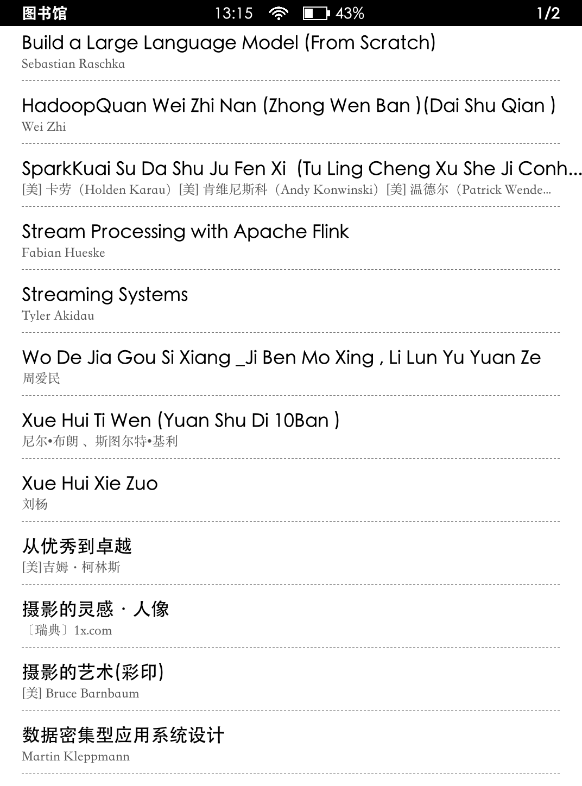
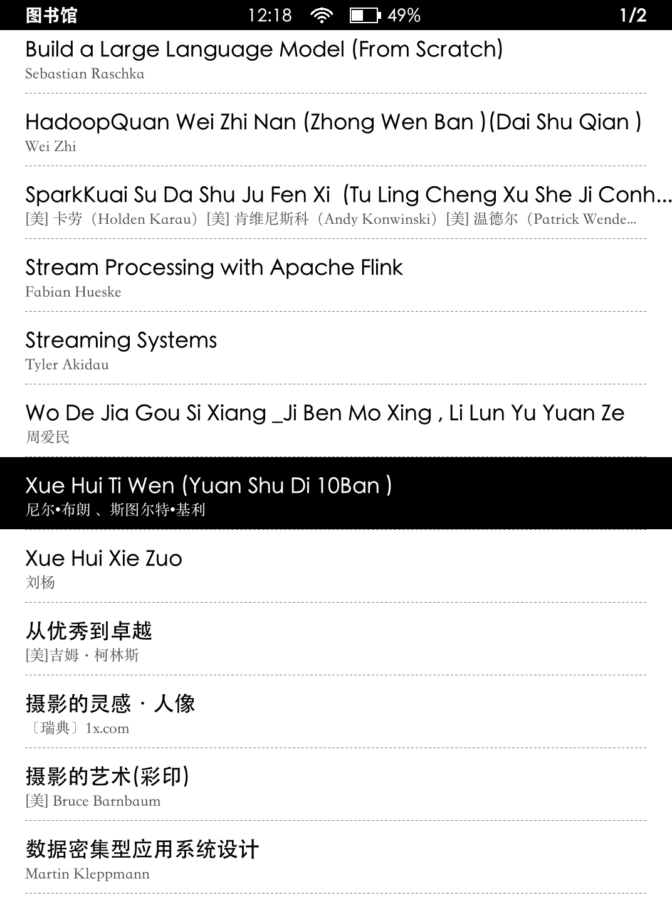
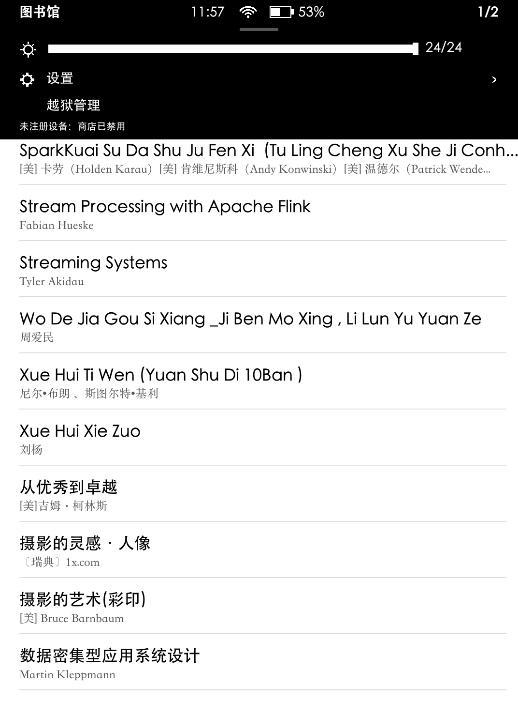

# kindle-powerful

为已越狱的 Kindle Paperwhite 4 提供自绘图书馆主页，保留 Amazon 原生阅读器，并附带 macOS Wi-Fi SSH 部署工具。

## 功能

- 原生 X11 应用与默认主页注册，开机启动，锁屏唤醒恢复。
- 图书列表、作者、分页、密集短虚线，选中黑底白字与开书反馈。
- 上下或左右滑动翻页；阅读器左上角长按约2秒返回图书馆。
- 时间、Wi-Fi、电量状态栏；下拉亮度、设置和 Jobman“越狱管理”。
- macOS Intel/Apple Silicon 通用部署器：连接检查、部署、恢复系统主页。
- 可选 KPP 注册检测补丁，默认不勾选，严格校验文件哈希，先备份再原子替换。

## 真机截图

Paperwhite 4 / 固件 5.17.1.0.3 实机采集，点击图片查看原图。

| 自绘图书馆 | 图书选中反馈 | 下拉快捷面板 |
| --- | --- | --- |
| [](docs/images/library-pw4.png) | [](docs/images/selection-pw4.png) | [](docs/images/quick-panel-pw4.png) |

## 适配范围

当前仅在 **Paperwhite 4 / 固件5.17.1.0.3 / 1072×1448 / 8位X11** 验证。深度休眠恢复已获得用户真机确认。其他型号、固件和阅读文件需要单独验证；本项目不承诺阅读器性能提升。

需预先完成越狱、安装 Jobman 并开启 Wi-Fi SSH。安装包不执行越狱，也不提供完整固件或设备字体。详细条件见[部署前置条件](docs/deployment-prerequisites.md)。

## 构建 macOS 应用

在安装了 Go 1.22+ 和 Xcode Command Line Tools 的 Mac 上运行：

```sh
sh scripts/build-macos-deployer.sh
```

输出：`dist/Kindle Library Deployer.app` 与 `dist/Kindle-Library-Deployer-macOS.zip`。构建同时生成 Kindle ARM 载荷；目标 Mac 无需安装 Go。

打开应用，填写 Kindle 的 Wi-Fi IP。用户名默认 `root`、密码默认 `kindle`，均可修改；密码按设计明文显示，仅用于本次操作。先检查连接，再部署。自定义密码不写入配置或日志。注册补丁仅在勾选后安装，写入后需重启 Kindle 生效。

应用为临时签名，未经过 Apple Developer ID 签名、公证。macOS15及以上需允许应用访问本地网络。

## 命令行部署与恢复

```sh
cd tools/kindle-library
go test ./...
go vet ./...
GOOS=linux GOARCH=arm GOARM=7 CGO_ENABLED=0 go build -trimpath -ldflags='-s -w' -o /tmp/kindle-library-native .
cd ../..
export KINDLE_HOST=192.168.1.100
export KINDLE_USER=root
read -r -s KINDLE_PW
export KINDLE_PW
sh scripts/install-native-home.sh /tmp/kindle-library-native
```

恢复系统默认主页：

```sh
sh scripts/remove-native-home.sh
```

安装会更改默认应用注册和 `/etc/upstart` 启动任务。设备备份保存于 `/mnt/us/library-home-backup/`；KPP原生阅读服务保持可用。恢复主页不会同时恢复注册检测补丁，详见[安装与恢复](docs/native-default-home.md)。

## 验证范围

PW4真机验证涵盖默认主页、MOBI/AZW3开书、返回、设置、滑动、Jobman入口及短暂锁屏；深度休眠为用户反馈。部署包后端已实机验证SSH、传输及安装。macOS GUI已在Intel Mac启动并检查布局，Apple Silicon版本仅交叉构建，未单独实机启动。

## 许可证与致谢

本项目代码采用 [MIT](LICENSE)。依赖与参考实现包括 [jezek/xgb](https://github.com/jezek/xgb)、[Go x/image](https://pkg.go.dev/golang.org/x/image)、[Go x/text](https://pkg.go.dev/golang.org/x/text) 和 [KPP_Patch](https://github.com/KindleModding/KPP_Patch)。对应许可见 [third-party](third-party/)。注册补丁基于固定上游提交，仅附带已验证的8字节差异，未附带完整 Amazon 主页文件。
